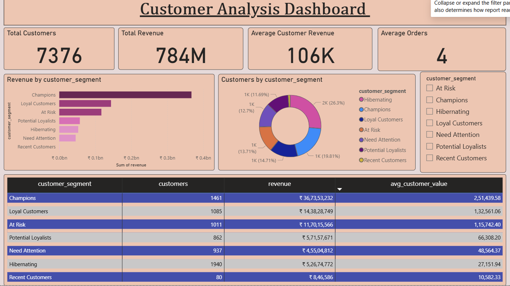

# Customer Segmentation & Retention Analytics

## Project Overview

This project focuses on analysing customer purchasing behaviour in an Indian e-commerce business using RFM (Recency, Frequency, Monetary) analysis.

The objective is to identify valuable customer segments, understand purchasing patterns, and develop data-driven strategies to improve customer retention and business performance.

## Business Objectives

- Identify high-value and loyal customers.
- Understand customer purchasing behaviour.
- Identify customers at risk of becoming inactive.
- Analyse revenue contribution across customer segments.
- Recommend strategies to improve customer retention.

## Tools & Technologies

| Tool | Purpose |
|---|---|
| Python | Data cleaning, exploration and RFM analysis |
| Pandas | Data manipulation and analysis |
| SQL | Customer-level analysis and business queries |
| Power BI | Interactive dashboards and visualisation |
| GitHub | Project documentation and version control |

## Dataset Description

The project uses a synthetic Indian e-commerce dataset containing four datasets:

| Dataset | Description |
|---|---|
| Customers | Customer demographic and location details |
| Orders | Order dates, status and customer information |
| Products | Product categories and details |
| Order Items | Product quantities, prices and order-level details |

**Analysis Period:** January 2024 – August 2026

**Note:** The dataset is synthetic and created for learning and portfolio demonstration purposes.

## RFM Analysis Methodology

RFM analysis is used to evaluate customer behaviour based on three key metrics:

| Metric | Definition | Business Meaning |
|---|---|---|
| Recency | Days since the customer's last purchase | How recently the customer purchased |
| Frequency | Total number of purchases | How often the customer purchases |
| Monetary | Total customer spending | How much the customer spends |

Customers were scored and grouped into meaningful segments based on their RFM values.

### Customer Segments

The analysis identified the following customer segments:

- Champions
- Loyal Customers
- Potential Loyalists
- Recent Customers
- Need Attention
- At Risk
- Hibernating

## Customer Segmentation Results

The RFM analysis identified 7,376 customers across seven segments.

| Customer Segment | Customers | Revenue (₹) |
|---|---:|---:|
| Champions | 1,461 | 367,353,231.82 |
| Loyal Customers | 1,085 | 143,828,748.52 |
| At Risk | 1,011 | 117,015,566.43 |
| Potential Loyalists | 862 | 57,157,671.27 |
| Hibernating | 1,940 | 52,674,772.36 |
| Need Attention | 937 | 45,504,812.07 |
| Recent Customers | 80 | 846,586.16 |
| **Total** | **7,376** | **784,381,388.63** |

### Key Performance Indicators

- Total Customers: 7,376
- Total Revenue: ₹78.44 Crore
- Average Revenue per Customer: ₹1,06,342
- Average Orders per Customer: 3.89
- Average Recency: 281 Days

## Business Insights & Recommendations

### Key Business Insights

1. **High-value customers:** Champions and Loyal Customers contribute approximately 65.2% of total revenue.
2. **Customer reactivation opportunity:** Hibernating customers form the largest segment, with 1,940 customers.
3. **Retention risk:** 1,011 customers are classified as At Risk and require targeted engagement.
4. **Growth opportunity:** Potential Loyalists can be encouraged to make repeat purchases.
5. **New customer engagement:** Recent Customers can be nurtured through second-purchase incentives.

### Business Recommendations

| Customer Segment | Recommended Strategy |
|---|---|
| Champions | VIP rewards and exclusive benefits |
| Loyal Customers | Loyalty programmes and cross-selling |
| Potential Loyalists | Repeat purchase offers |
| Recent Customers | First-to-second purchase incentives |
| Need Attention | Personalised engagement campaigns |
| At Risk | Targeted retention offers |
| Hibernating | Win-back and reactivation campaigns |

These recommendations aim to improve customer engagement, strengthen loyalty and reduce customer inactivity.

## Power BI Dashboard Previews

### 1. Customer Segmentation Overview

This dashboard presents customer distribution, revenue contribution and segment performance.

## Project Workflow

The project followed these key stages:

1. **Data Understanding:** Explored the four e-commerce datasets.
2. **Data Preparation:** Cleaned and prepared data using Python.
3. **Exploratory Data Analysis:** Analysed customer and purchasing patterns.
4. **RFM Analysis:** Calculated Recency, Frequency and Monetary metrics.
5. **Customer Segmentation:** Grouped customers into seven meaningful segments.
6. **Dashboard Development:** Created interactive Power BI dashboards.
7. **Business Recommendations:** Identified retention opportunities and proposed strategies.

## Key Learnings

- Applied RFM analysis to customer segmentation.
- Developed customer-level business insights.
- Practised data cleaning and exploratory analysis using Python.
- Designed interactive Power BI dashboards.
- Translated analytical findings into business recommendations.

## Conclusion

This project demonstrates how customer transaction data can be transformed into meaningful business insights.

By identifying high-value, loyal, at-risk and inactive customers, businesses can develop targeted retention strategies and make more informed decisions.

---

**Project Type:** Business Analytics | Customer Segmentation | Retention Analytics

**Dataset:** Synthetic Indian E-commerce Dataset

**Tools:** Python | SQL | Power BI | GitHub

### 2. Customer Behaviour Analysis

This dashboard explores customer recency, purchase frequency and customer value.

## Project Status

Completed:
- Data exploration and preparation
- Customer RFM analysis
- Customer segmentation into seven groups
- Power BI dashboard development
- Business insights and recommendations
- SQL query documentation
- GitHub project documentation

## Limitations

- The project uses a synthetic e-commerce dataset.
- Retention strategies are recommendations and have not been tested through live campaigns.
- SQL queries are documented for MySQL; execution results are not included.

## Author

MBA – Business Analytics

Areas of Interest: Business Analysis, Customer Analytics, Data Visualization and Business Intelligence.
